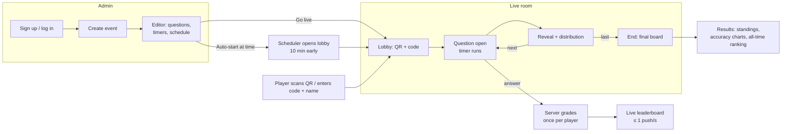

# Trivyo backend

Go (Gin) server for live MCQ tests. It provides admin accounts, an event and question editor API, WebSocket rooms (run manually, on autopilot, or on a schedule), leaderboards, and per-question stats. It is designed for many players on poor mobile networks.

## Run

```bash
cp .env.example .env      # set MON (MongoDB) and ADMIN_SECRET
go run .
```

You need MongoDB. Redis is optional; it is only used as a cache for live events, and the RedisJSON module is used if the server has it.
For a quick local database: `docker run -d -p 27017:27017 mongo:7`.

## How a test flows



The host can run each step by hand (Start, Reveal, Next), hand over to **auto-run** at any point, or schedule the test to **auto-start** with no host present.

### Reconnects

```mermaid
sequenceDiagram
  participant P as Player (flaky network)
  participant S as Server
  P->>S: answer {questionno, choice}
  Note over P,S: connection drops before the result arrives
  P-->>P: answer kept as "pending"; banner: reconnecting
  P->>S: reconnect (same name + private rejoin key)
  S->>P: welcome (score, board) + open question (time left) + your answer
  P->>S: resend pending answer
  S->>P: original result (resumed), with no double points
```

## HTTP API (prefix `/api`)

| Method | Path | Auth | Purpose |
|---|---|---|---|
| POST | `/admin/signup` | – | `{username, password, code?}` → `{token}` (`code` needed if `ADMIN_SIGNUP_CODE` is set) |
| POST | `/admin/login` | – | `{username, password}` → `{token}` |
| GET | `/admin/me` | admin | current admin |
| POST | `/create-event` | admin | `{Nameofroom, DateofQuiz, StartTime, Questions?, ScheduledAt?, AutoStart?}` → `{roomid, event}` |
| POST | `/add-question` | admin | `{roomid, question: {Question, Options[], Correctoption: "<index>", Eachquestiontime?}}` |
| GET | `/admin/events` | admin | your events |
| GET/PUT/DELETE | `/admin/events/:roomid` | admin | read, save (full replace), delete (refused while live) |
| GET | `/rooms` | – | recently played rooms |
| GET | `/rooms/:roomid` | – | public info: `live`, `scheduledat`, `autostart`, `finished` |
| GET | `/rooms/:roomid/leaderboard?limit=` | – | room ranking (ties go to the faster player) |
| GET | `/rooms/:roomid/stats` | – | per-question answer distribution (only after the room ends) |
| GET | `/leaderboard?limit=` | – | all-time ranking across every room, plus totals |

Admin endpoints take `Authorization: Bearer <token>`. JSON responses are gzipped.

## WebSockets

- **Host:** `/api/host?roomid=ROOM&token=TOKEN` makes the room live. It accepts:
  - `{"type":"question","questionno":0}` or `{"type":"next"}`
  - `{"type":"reveal"}`
  - `{"type":"auto","delay":5}` to auto-run the rest, and `{"type":"manual"}` to stop auto-run
  - `{"type":"leaderboard"}`
  - `{"type":"end"}`
- **Player:** `/api/connect?roomid=ROOM&userid=NAME&key=REJOINKEY`. It accepts `{"type":"answer","questionno":0,"choice":1}` and `{"type":"ping"}`.
- **Server frames:**
  - `welcome`: the host's version includes `state` for resuming
  - `question`: has `deadline` and the server's `now`, and never includes the answer
  - `result`: has `resumed: true` when it repeats an earlier result
  - `answer`: sent to hosts
  - `players`
  - `leaderboard`: top 10, sent to players
  - `hostboard`: top 100, sent to hosts
  - `reveal`: includes the answer distribution
  - `room`: sent when auto mode or the start time changes
  - `end`
  - `error`: has a `code` (`no_question`, `closed`, `late`, `invalid`, `duplicate`)

Rules:
- **One answer per player per question.** A unique index enforces this. A repeat returns the original result.
- **Answers count only for the open question,** until its timer runs out plus a 1.5 s grace period.
- **A correct answer is worth 50 points.**
- **Same name on a new socket:** with the same key it takes over (a refresh or a second tab); with a different key it is refused with 409.
- **Rate limit:** 4 messages per second, with bursts of 8. Clients that keep flooding are disconnected.
- **Network:** WebSocket permessage-deflate, 25 s pings (which keep mobile NATs open), and leaderboard pushes coalesced to at most one per second.

## Tests

With the server running (`MON=… go run .`):

```bash
node tests/e2e.mjs                 # 38 checks: auth, editor, full game, rankings
node tests/edge.mjs                # 58 checks: reconnects, timing, abuse, host drop, autopilot, schedule
node tests/load.mjs http://localhost:8080 100 10 8 report.json   # load test
node tests/bots.mjs ROOMCODE 100   # fill a live room with bots to watch in the browser
```

### Load test results (one machine, Mongo + Redis in Docker)

The players were a mix of 60% good links (5–40 ms), 30% 3G-like links (150–400 ms), and 10% flaky links (300–800 ms that also drop and reconnect mid-quiz).

| | 100 players × 10 questions | 300 players × 5 questions |
|---|---|---|
| Finished / answers accepted | 100/100 · 952/952 | 300/300 · 1438/1438 |
| Score mismatches (client vs server) | **0** | **0** |
| Question fan-out at the server (p50 / p99) | 7 / 12 ms | 19 / 48 ms |
| Question arrival including network (p50 / p95) | 40 / 547 ms | 61 / 635 ms |
| Answer round trip (p50 / p95) | 61 / 1154 ms | 62 / 1144 ms |
| Drops recovered / recovery time (p50) | 10/10 · 1.1 s | 30/30 · 0.9 s |
| Data per player for the whole quiz | 65 KB | 39 KB |
| Server CPU / peak memory | ≈ 2% of one core / 57 MB | |
